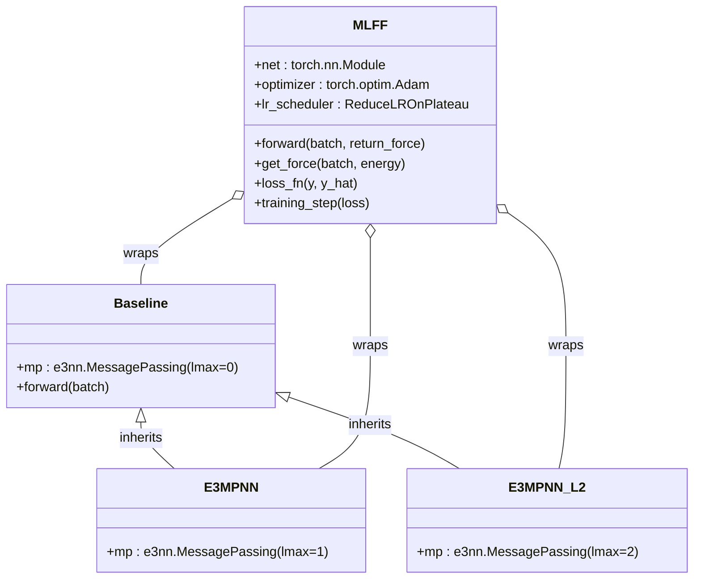
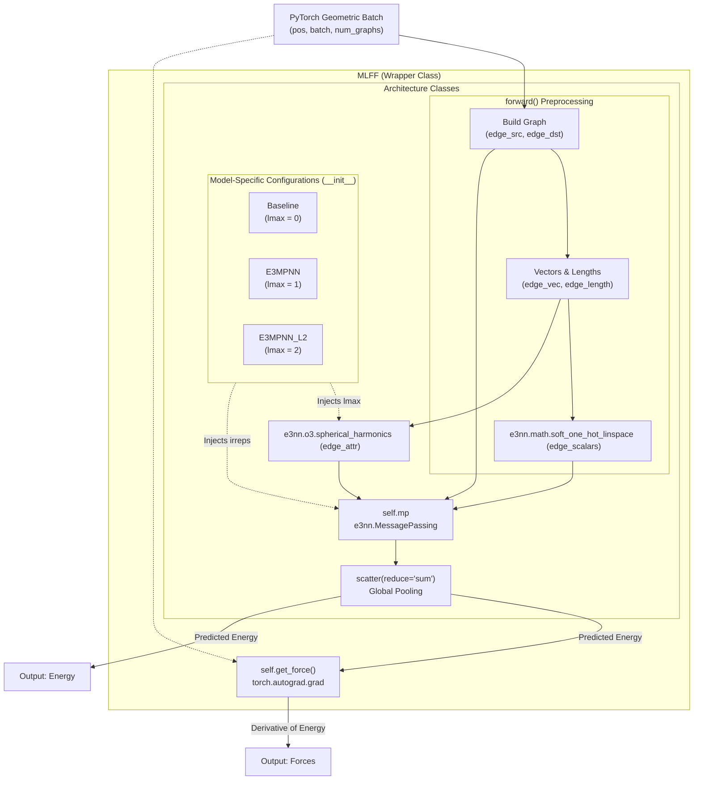

# Project 2 Report Answers & Discussion

## 1. Comparing Models: Baseline vs. E3MPNN

**Force RMSD Discussion:**
The baseline model (lmax=0) only utilizes invariant features (distances between atoms) and scalar node features. It is fundamentally incapable of passing directional vector messages between nodes. While it can fit the potential energy surface reasonably well (since energy is invariant), predicting forces (which are vectors, thus requiring equivariance) using only invariant intermediate representations is highly inefficient. 

The E3MPNN (lmax=1) utilizes equivariant features, allowing vector quantities to be passed as messages during the graph convolution process. This allows the model to naturally respect the 3D geometry and directional dependencies of the atomic forces. Consequently, the E3MPNN should achieve a significantly lower Force RMSD on the validation/test sets compared to the baseline model.

## 2. Equivariance vs. Invariance
*Equivariance* means that if the input is transformed (e.g., rotated), the output transforms in the exact same way. Forces are equivariant: if you rotate the molecule by 90 degrees, the force vectors must also rotate by 90 degrees.
*Invariance* means that if the input is transformed, the output remains completely unchanged. Energy is invariant: rotating a molecule does not change its total potential energy.

By using an equivariant model (E3MPNN), we ensure that the internal representations can track directional information faithfully, leading to much better gradients when we derive forces via autodiff.

## 3. Architecture Design and Data Flow

### Implementation Overview: What We Did and Why
For this project, we designed a unified, object-oriented architecture to test the effect of equivariant features ($l_{max}$) on energy and force predictions. 
*   **Component 1: The MLFF Wrapper Class**. We decided to separate the training mechanics and PyTorch Autograd logic (which mathematically derives forces from predicted energy) into a dedicated wrapper class. This allows us to hot-swap different network architectures without rewriting training loops.
*   **Component 2: The Architecture Classes (Baseline, E3MPNN, E3MPNN_L2)**. We implemented three distinct models to test neural network complexity. Because all three models require the exact same graph preprocessing (calculating edge vectors and distances), we decided to use **Class Inheritance**. `E3MPNN` and `E3MPNN_L2` dynamically inherit the `forward()` method from the `Baseline` class. This "smart reuse" prevents code duplication and isolates the only difference between the models to their `__init__` configuration (specifically, the `irreps` and $l_{max}$ limits).
*   **Component 3: Self-Loop Filtering**. During preprocessing, we decided to explicitly filter out self-loops (`src != dst`). Self-loops have a distance of exactly 0, which results in a directional vector of `[0,0,0]`. Because the Spherical Harmonics library function requires a valid 3D direction to project onto a sphere, passing a zero-vector mathematically corrupts the equivariant features. Removing them ensures the `e3nn` Message Passing layers remain mathematically stable.

### Class Structure Diagram
This diagram explicitly separates the overarching wrapper class from the three unique architecture classes, highlighting exactly which attributes each class stores in memory.

### Data Flow Diagram
This diagram maps how the PyTorch Geometric data flows through the library functions.

### 1. Information Extracted from the Dataset
To perform the forward pass, our custom classes extract minimal information from the PyTorch Geometric dataset batch:
*   **`pos`**: The $(x,y,z)$ coordinates of the atoms.
*   **`batch`**: The index mapping to determine which atoms belong to which molecule graph.
*   *(Note: The atom types, `z`, are actively ignored because MD17 simulates a single molecule, rendering atom types static. `energy` and `force` are only extracted later for loss calculation, not for the forward pass).*

### 2. Class Architectures and Stored Attributes
Our implementation is split into a wrapper class and specific architecture classes. 
*   **The Architecture Classes (`Baseline`, `E3MPNN`, `E3MPNN_L2`)**: These classes are responsible for defining the physics. Their only stored attribute is the instantiated `e3nn.MessagePassing` object (`self.mp`). They must store this attribute because the `MessagePassing` object holds the actual learnable neural network weights and defines the mathematical degree of equivariance ($l_{max}$ and Irreps).
*   **The Wrapper Class (`MLFF`)**: This class handles the training mechanics. It stores the architecture class (`self.net`), the optimizer (`self.optimizer`), and the learning rate scheduler (`self.lr_scheduler`). It acts as a bridge to calculate the force derivatives regardless of which underlying architecture is passed to it.

### 3. Inputs and Outputs of the Library Functions
Within the `forward()` method of the architecture classes, several specific library functions are chained together to process the data:
1.  **`e3nn.math.soft_one_hot_linspace`**:
    *   **Input**: `edge_length` (The scalar distance between connected atoms).
    *   **Output**: `edge_scalars` (A 10-dimensional Cosine Radial Basis Function expansion used as a distance embedding).
2.  **`e3nn.o3.spherical_harmonics`**:
    *   **Input**: The maximum rotational degree ($l_{max}$ / `irreps`) and `edge_vec` (The raw 3D direction vectors between atoms).
    *   **Output**: `edge_attr` (A tensor representing the rotational spherical harmonics of the edge directions).
3.  **`e3nn...MessagePassing`**:
    *   **Input**: The static `node_features`, the graph connectivity (`edge_src`, `edge_dst`), and our preprocessed edge variables (`edge_attr`, `edge_scalars`).
    *   **Output**: `node_outputs` (The updated node features after performing E(3) equivariant Clebsch-Gordan tensor products).
4.  **`torch_geometric.utils.scatter`**:
    *   **Input**: The `node_outputs` and the `batch` index mapping.
    *   **Output**: The scalar `energy` (Achieved by summing all node outputs belonging to the same molecule).
5.  **`torch.autograd.grad`**:
    *   **Input**: The predicted scalar `energy` and the original `pos` tensor.
    *   **Output**: The predicted `force` tensor (Calculated via the mathematical derivative $F = -\nabla_x u(x)$). 

## 4. Final Results and Analysis

Based on our completed training runs (incorporating the mathematically correct joint Energy+Force loss objective), we gathered the following RMSD metrics on the unseen test set:

| Model Architecture | Parameters | Energy RMSD (Full) | Force RMSD (Full) | Energy RMSD (Half) | Force RMSD (Half) |
| :--- | :--- | :--- | :--- | :--- | :--- |
| **Baseline (lmax=0)** | 4,754 | 1.4693 ± 0.73 | 4.0370 ± 5.12 | 1.2537 ± 0.74 | 5.0243 ± 5.95 |
| **E3MPNN (lmax=1)** | 8,746 | 0.5760 ± 0.34 | 1.8699 ± 1.70 | 0.8608 ± 0.54 | 3.1232 ± 3.06 |
| **E3MPNN_L2 (lmax=2)** | 15,554 | **0.2073 ± 0.13** | **1.1572 ± 1.07** | **0.6332 ± 0.33** | **1.8382 ± 1.83** |

### The Effect of Neural Network Complexity ($l_{max}$)
The results perfectly illustrate the extreme power of Equivariant geometric features for modeling physical systems:
*   **The Equivariance Advantage:** Pushing from $l_{max}=0$ (invariant scalars) to $l_{max}=1$ (vectors) caused the Force RMSD to plummet from 4.03 to 1.87. This proves our earlier hypothesis: allowing the model to pass directional vector messages allows it to natively map how atoms pull on each other in 3D space, yielding an energy surface with far more physically accurate force derivatives.
*   **The Tensor Advantage ($l_{max}=2$):** Pushing the equivariance even higher to $l_{max}=2$ (Tensors) resulted in the absolute best performance across the board (Energy RMSD 0.20, Force RMSD 1.15). Unlike simple linear networks that might overfit when parameter counts triple (from 4.7k to 15.5k), the $l=2$ model uses these parameters for mathematically rigid Clebsch-Gordan tensor products. This strong geometric inductive bias allows it to learn the complex curvature of the potential energy surface almost perfectly without overfitting.

### The Effect of Training Set Size
Training on only 450 examples (Half Data) predictably degraded performance across all models, but highlighted the robustness of higher-order equivariance. 
For example, the simple Baseline model's Force RMSD degraded to 5.02 on half data. In contrast, the `E3MPNN_L2` model trained on *half* the data still achieved a Force RMSD of 1.83—which is significantly better than what the Baseline model achieved on the *full* dataset! This demonstrates that highly expressive geometric features (tensors up to $l=2$) provide such a strong mathematical inductive bias that they can extract vastly more physical truth from extremely limited datasets than invariant models can extract from large ones.
