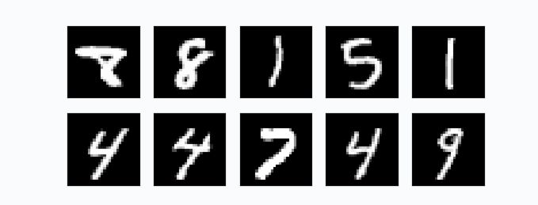
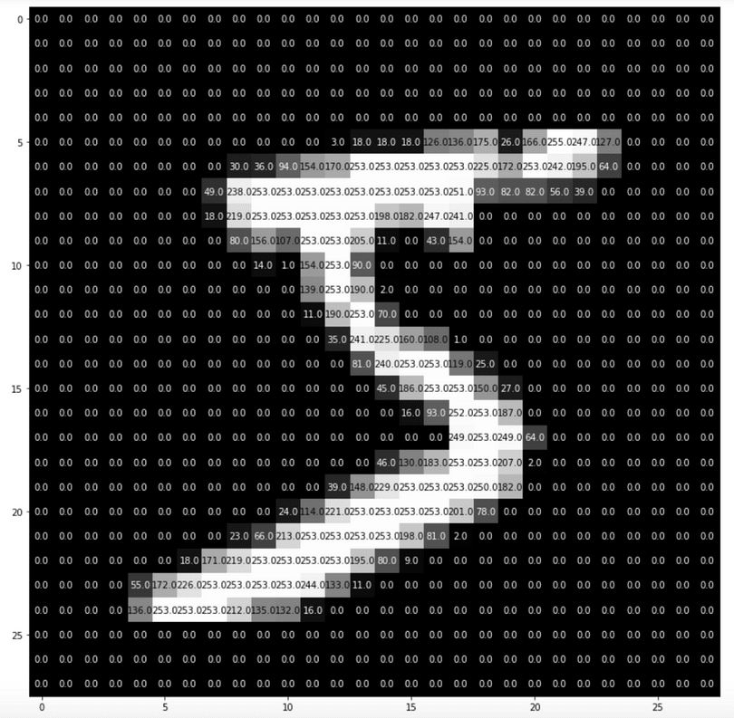
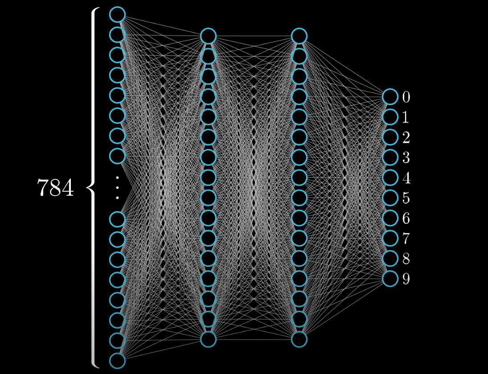
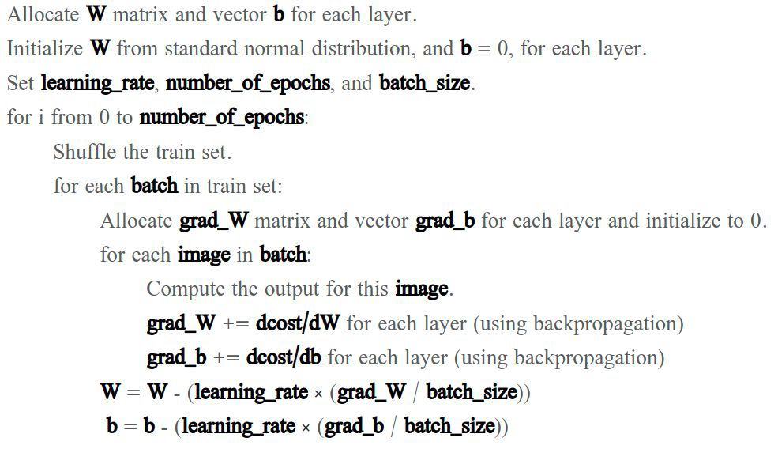
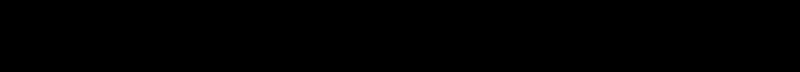
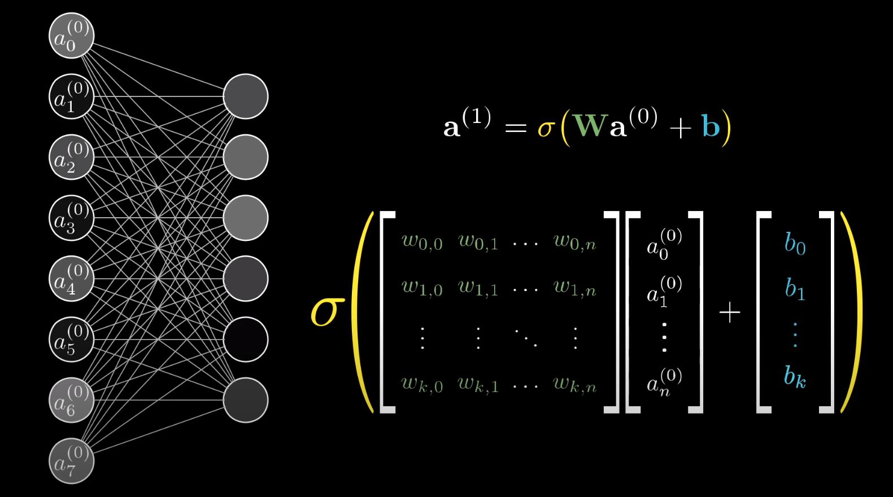
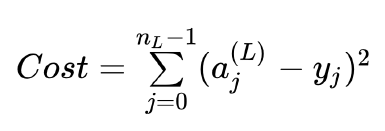
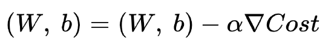

# ANN
One of the applications of neural networks is Pattern Recognition.
In this project, we try to recognize handwritten digits via a neural network. This is one of most
classic and famous image processing problems that different people use different methods like
K-Nearest Neighbor, SVM, and different neural network architectures. Here we want to solve this problem with the help of Feedforward Fully Connected neural networks.

In this project, we receive black and white images as input, in which a digit is written in each one. Our model must recognize what number is depicted in every image.

The dataset we are going to use is MNIST. The images of this dataset have dimensions of 28x28 and as a result, the input layer of our neural network has 28x28=748 neurons and each neuron receives the brightness level of that pixel as an int number from 0 to 255, like the below example:

Of course, we have to divide the input values by 256 because our activation function gets a number in the range of [0,1] as an input. Considering that our model is used to recognize one of 10 English digits, the output layer of our neural network will have 10 neurons, and the corresponding number with the neuron that has the most activation is selected as the digit recognized by our model. For this neural network, We consider two hidden layers, each of which has 16 neurons. The architecture of our model can be seen below:

The pseudocode of our neural network learning process using the "Stochastic Gradient Descent" method is as follows:

The idea of this method is that instead of working with one data point at a time for training, we can divide the data into sections called
mini-batch and get the gradient of each sample of that mini-batch, and finally get the average of gradients and update the weights. This will lessen the calculations in each state and reduce the learning time of our model. The number of samples we work with each step is called batch size. Also, Every time all the mini-batches (and therefore all the samples) are used is called an epoch.

# Feedforward
As you know To calculate the output from the input in neural networks, the following operations are performed in each layer:

As a result, in the implementation of the neural network for the weights between both layers, we consider a k by n matrix, where k is the number of neurons in the next layer and n is the number of neurons in the current layer. Therefore, each row of the w matrix contains the weights of a specific neuron in the next layer. also; For the biases between both layers, a separate vector has been considered, the dimensions of which are equal to the number of neurons in the next layer.

# Backpropagation

The learning process of the neural network means minimizing the Cost function:

This is done with the help of the Gradient Descent method, which by obtaining the partial derivatives of the Cost function with respect to all parameters (that is, the gradient), We make the desired changes to the parameters:

Obtaining these derivatives is done with the help of backpropagation.

As a machine-learning algorithm, backpropagation performs a backward pass to adjust the model's parameters, aiming to minimize the mean squared error (MSE) In a single-layered network, backpropagation uses the following steps:
1. Traverse through the network from the input to the output by computing the hidden layers' output and the output layer. (the feedforward step)
2. In the output layer, calculate the derivative of the cost function with respect to the input and the hidden layers.
3. Repeatedly update the weights until they converge or the model has undergone enough iterations.

# Testing
To test the model we train the model on all 60,000 photos of the Train collection, with batch_size equal to 50, learning rate equal to 1, and the number of epochs equal to 5. After training the model, We show the accuracy of the model for the Train set and also for the Test set, and we also plot the average cost. It is expected that the accuracy of the model for the Train and Test data set is about 90%.
By accuracy of the model, we mean the number of correctly recognized photos divided by the total number of photos. 

Keep in mind that the output is calculated according to the aforementioned formulas i.e. by multiplying and adding matrix/vector and applying the sigmoid function, which is the activation function we use.

    
    

