# Signal Processing

At first, we are gonna use the Matplotlib and NumPy library to plot some continuous and discrete signals. These signals can be seen below:

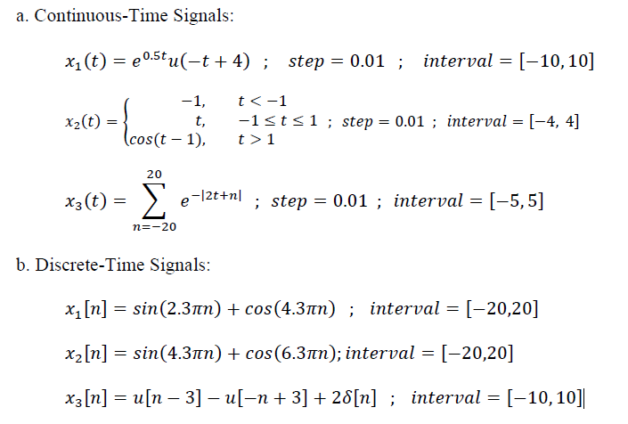

We plot these signals in signalsPlot.py. The plots of these functions can be seen below:

x1(t):

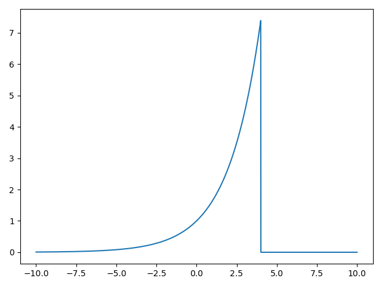

x2(t):

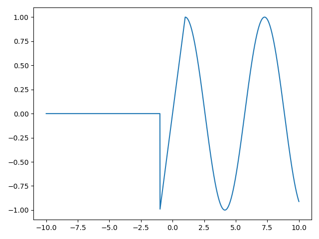

x3(t):

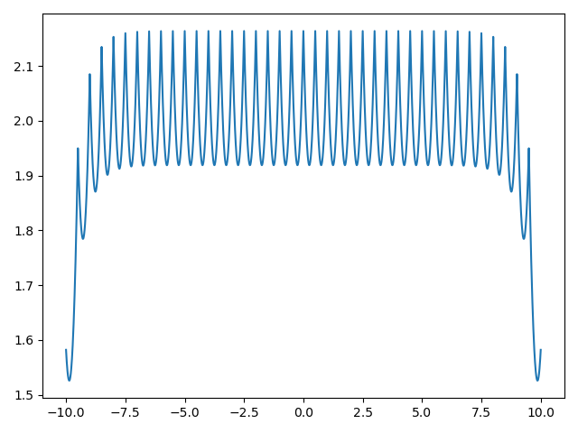

x1[n]:

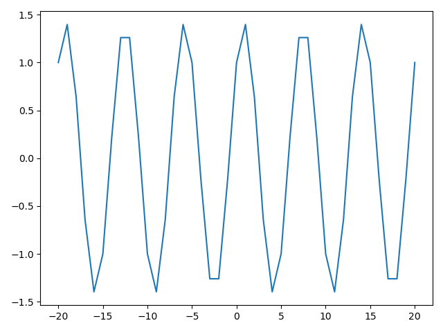

x2[n]:

x3[n]:

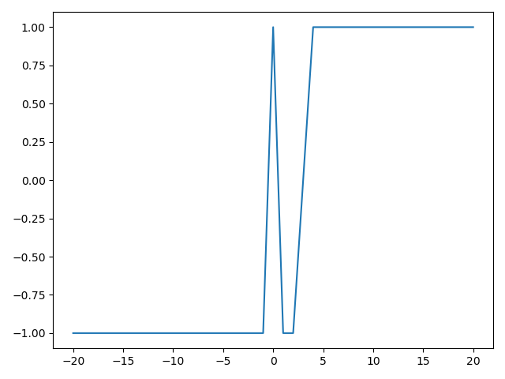

# Convolution
Next, we are gonna program a function that calculates the convolution of two inputted  functions and plots it. For testing, we use the two sets of functions below as input:

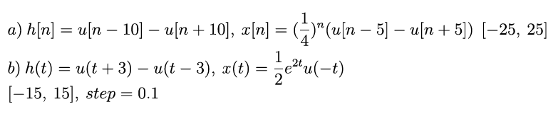

The outputs can be seen below:

a)

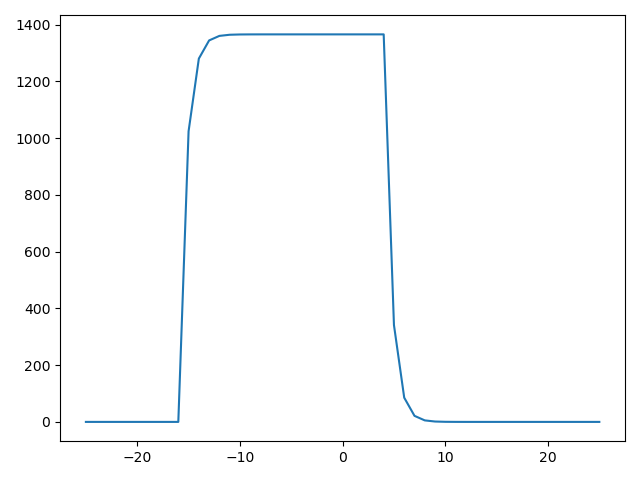

b)

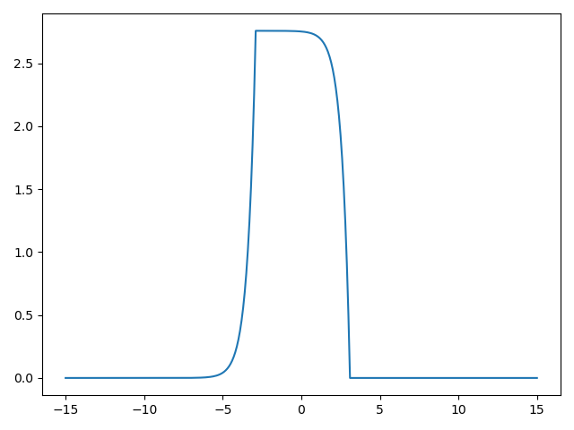

# Fourier transform

Sound is a kind of continuous mechanical wave that is created by the vibration of air particles. When this wave reaches our eardrum, it vibrates and we hear the sound. If we consider one of the particles of the environment (for example, an air molecule near the ear) and draw its displacement relative to its equilibrium point at different times, the sound waveform that we hear is created.

Digital audio is also made by sampling this continuous wave at short intervals. For example, the sounds that we work with in this project have a sampling rate of 44100 Hz (that is, sampling at an interval of 1/44100 S).
In this exercise, we want to calculate and check the Fourier series of several audio signals. For this purpose, we use four audio files from wave4 to wave1 and open them with Scipy.io.wavfile read function, and draw their graph in the time domain (note that for the horizontal axis, each 44100 sample is equal to one second. We can also plot the first few samples [for example, the initial 500 samples] to see the signals better.)
We know that the Fourier series coefficients of continuous-time signals are obtained from the following equation:

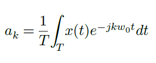

By expanding on the above equation, we can calculate the real part (b_k) and the imaginary part (c_k) of each coefficient separately like below:

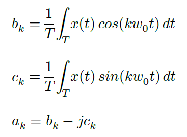

For each of the four given signals, we calculate their Fourier series coefficients (b_k) and (c_k) for k=0 till k = 10 manually and draw the graph of |a_k|s. Below we plot both the waves and their |a_k|s.

wave1:

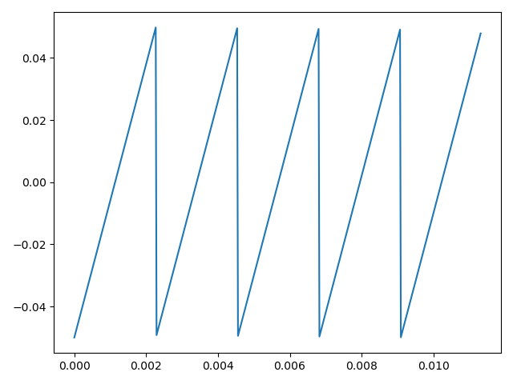

wave1 |a_k|s:

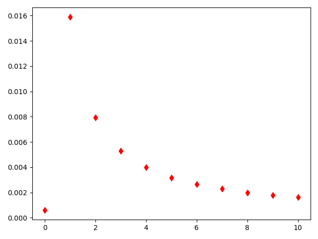

wave2:

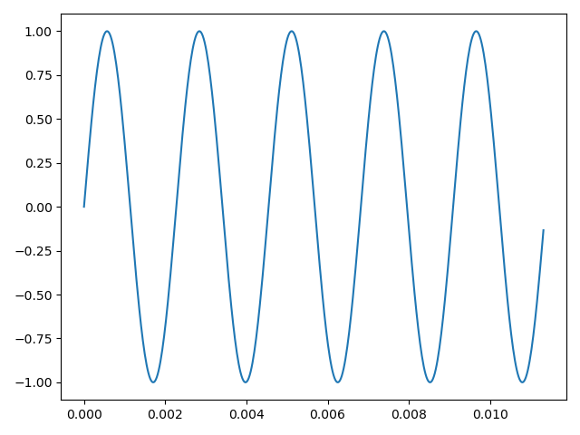

wave2 |a_k|s:

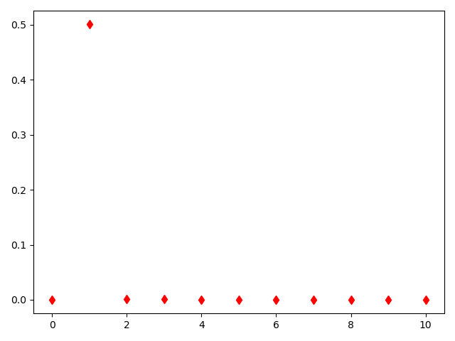

wave3:

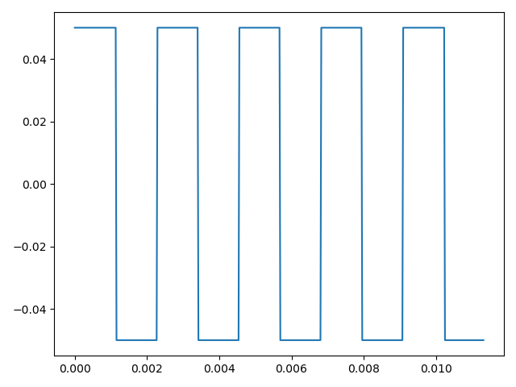

wave3 |a_k|s:

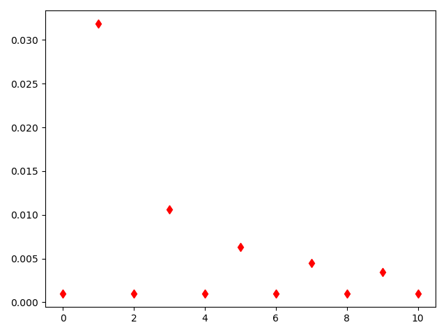

wave4:

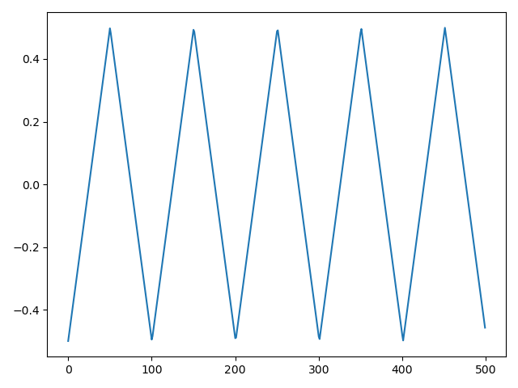

wave4 |a_k|s:

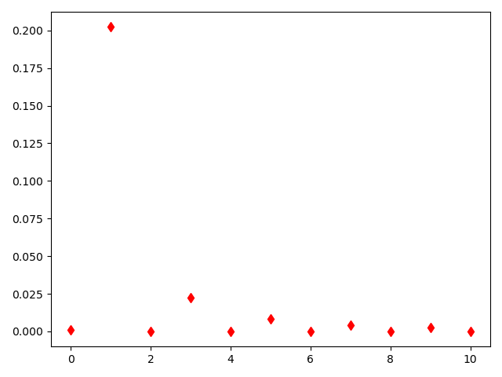

as can be seen, by the plots, the sound file wave1.wav has the most complete sound, which we can understand both by listening to it and by looking at the graph of |a_k| coefficients, which shows us fourier series signals contribute to the consturction to wave1 more than the other files and have more effect in the construction of wave1, as seen by the coefficients.

Next, we open the bonus audio file and with the help of the function we wrote and obtain its Fourier series coefficients and draw them in a graph below(the periodicity of this signal is approximately 229.34 milliseconds).

Bonus:

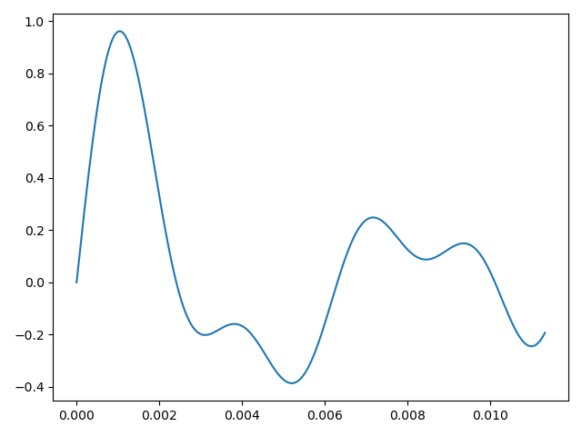

bonus |a_k|s:

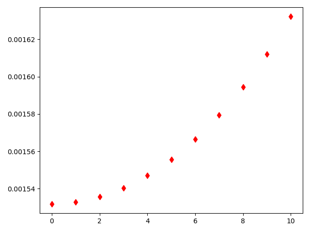

If we pay close attention, the 5 dominant frequencies in this signal are rational coefficients of each other, and for this reason, the sound of this signal is more pleasant than the previous ones. Also there is a more pleasant shape to the progression of these frequencies. The five dominant frequencies are in the form of e^-jwk for k from 5 to 10, and with w=2pi/(10114×(1/44100)).

# Pyzam

Most likely, you are familiar with music recognition systems (such as Shazam). It is interesting to know that music recognition in these systems is done with the help of Fourier transform. In this part, we want to implement such a system ourselves!

We know that by using the Fourier transform, we can move the signals from the time domain to the frequency domain. By doing this, the constituent frequencies of a signal (which could not be identified in the time domain) are determined. For example, consider the following audio signal in the time domain. Suppose we want to obtain the constituent components of this signal.

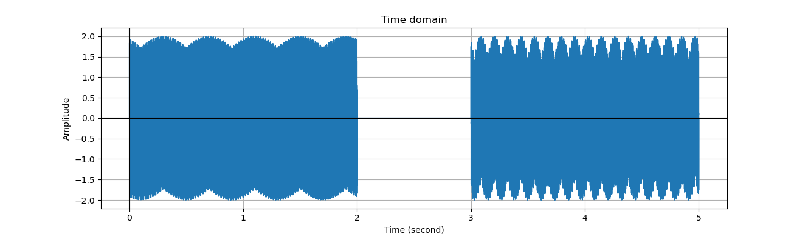

As you can see, the above diagram gives complete information about signal changes in the time domain. For example, we notice that this sound is silent between 2 and 3 seconds. But this chart does not give us any information about the frequencies in other times. The following graph is obtained by calculating and plotting the Fourier transform using the fft function in numpy.

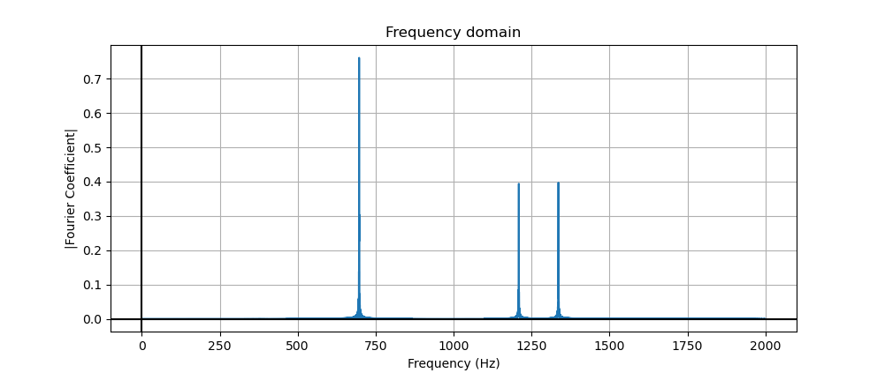

As you can see the output is similar to what we have implemented in the Fourier transform section, however in this section we use numpy for it's better performance. This chart gives us complete information about the range of frequencies in the signal. For example, we notice that frequencies around 750 and 1250 Hz make up our signal. But the chart above does not give us any information about when each of these frequencies were present.

To obtain this information, we need a graph that gives us a state between the time and frequency domains. Suppose we break the given signal into shorter seperate time windows (for example, 100 milliseconds), and for each time window we calculate its Fourier transform independently. Putting this instantaneous transformation together, we get a frequency versus time graph. We arrive at what is called the spectrogram or spectrogram of the signal. For example, for the mentioned signal, its spectrogram is as follows (brighter points mean that the Fourier transform value is larger at that point).

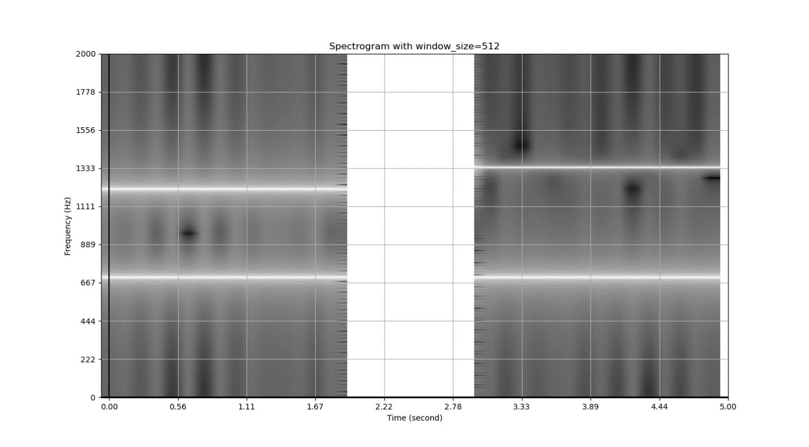

Now, it is clear from this graph that in the first 2 seconds the frequencies of about 666 and 1200 Hz and in the last 2 seconds the frequencies of about 666 and 1333 Hz formed our signal. Results that could not be obtained from any of the graphs of the time and frequency domains.

To build a music recognition system, we need to compare the spectrogram of the signals. In this section, we have two sets of audio files at our disposal. The data collection contains the original version of some music and the audio input by the user should be compared with all the members of this collection. The clip collection contains several examples of user inputs that you can use to test your code. To compare the signals, we follow the steps below for each of the signals:

1. Break the signal into 2048 sample windows (about 50 ms) and take the Fourier transform from each time window separately using numpy. We store this Fourier transform in the form of a matrix, each column of which is the Fourier transform output for a It is a time window.
2. Keep the data about frequency around 100 to 5000 Hz and remove the rest (you can use fftfreq to get the frequency corresponding to each fft output element).
3. Divide the frequencies of each time window into 6 baskets with equal sizes and consider the frequency that has the maximum value in each basket as the index frequency of that basket. To better understand this process, consider the following figure as an example. In this diagram, the frequency of the index of each basket in each time window is marked with a dot.

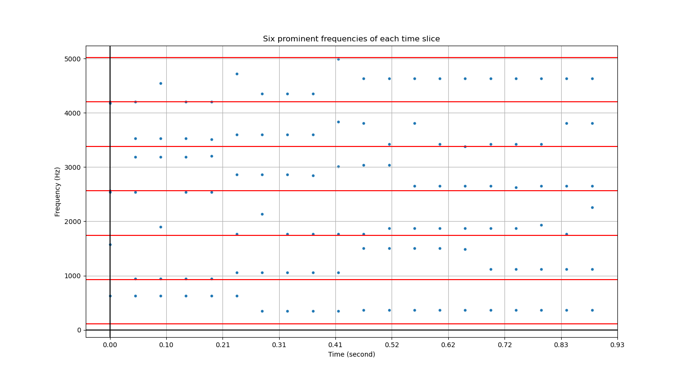

After going through the above steps for each signal, we have a matrix with 6 rows, each row represents the index frequency in one of the baskets and each column represents the 6 index frequencies of each time window, which we call signals noiseprint.

Now, to identify an input music, it is enough to compare its noiseprint with the noiseprint of the music we calculated earlier in our database (data set). For this, we use the similarity function. By receiving the noiseprint of the signal in the database in the first input and the noiseprint of the signal given by the user in the second input, this function returns their similarity in the form of a number. Finally, any signal from the database that is more similar to the user's input is selected as the detected music.

